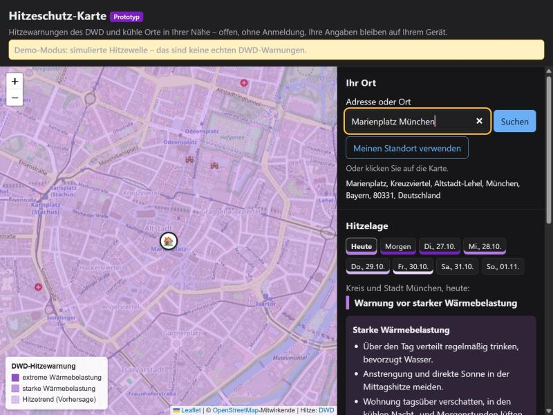
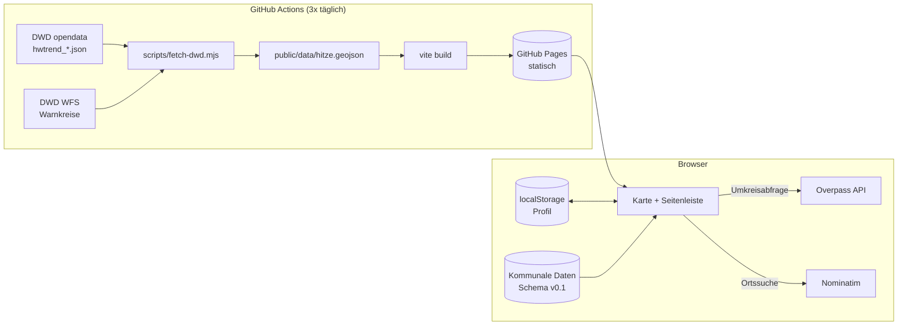

# Hitzeschutz-Karte (Prototyp)

Offene Karte für den Hitzeschutz in Deutschland. Sie verbindet:

- **amtliche Hitzewarnungen und den 8-Tage-Hitzetrend des Deutschen Wetterdienstes**, je Landkreis,
- **kühle Orte in der Nähe** (Trinkwasser, Bibliotheken, Gotteshäuser, Museen, Parks, Badestellen) aus OpenStreetMap und kommunalen Daten,
- **persönliche Hinweise** abhängig von einem optionalen Profil (Alter, Vorerkrankung, Medikamente, Schwangerschaft, Kleinkind, Arbeit im Freien, allein lebend). Das Profil **bleibt im Browser**.

Dazu gibt es einen **Entwurf für ein offenes Datenschema „Kühle Orte“**, mit dem Kommunen ihre Daten einheitlich veröffentlichen können. Ein solcher Standard fehlt bisher.



> Status: Prototyp. Keine medizinische Beratung. Im Notfall 112.

---

## Warum? Die Lücke

Hitze ist in Deutschland ein erhebliches Gesundheitsrisiko, besonders für ältere, pflegebedürftige und chronisch kranke Menschen, Schwangere, Säuglinge und Menschen, die im Freien arbeiten ([DWD-Hitzewarnsystem, Vortrag LZG NRW](https://www.lzg.nrw.de/LZG_2016/_media/pdf/service/Veranst/240610_hitze/GRAW_Abstract.pdf)). Viele Kommunen benennen deshalb in Hitzeaktionsplänen „Kühle Orte“ und „Kühle Räume“. Diese Informationen sind aber verstreut, uneinheitlich und selten maschinenlesbar:

| Befund | Quelle |
|---|---|
| Abgeordnete fordern eine **bayernweite digitale Karte bzw. App** kühler Orte und Räume, damit sie für vulnerable Gruppen bekannt und fußläufig erreichbar sind. | [Bayerischer Landtag, Schriftliche Anfrage Drs. 19/12542 vom 21.05.2026](https://www.bayern.landtag.de/www/ElanTextAblage_WP19/Drucksachen/Schriftliche%20Anfragen/19_0012542.pdf) |
| Antwort der Staatsregierung (24.06.2026): Es gibt **keine abschließende Liste** kühler Räume, **keine Mindeststandards**, **keine Daten zur Erreichbarkeit** („Eine Datenbeschaffung ist nicht geplant.“) und **keine zentrale Erfassung**. Bekannt sind 13 Kommunen mit eigenen Karten, jeweils in einem anderen Format (Geoportal, PDF, Beteiligungsplattform). | ebd. |
| Berlin betreibt gleich **drei verschiedene Kartenangebote**. Laut Presserecherche fehlen in den offiziellen Karten viele Orte, rund um den Gendarmenmarkt etwa zwei Einträge gegenüber rund 40 in einem privaten Angebot. | [Senatsverwaltung Berlin, Pressemitteilung 2025](https://www.berlin.de/sen/wgp/presse/2025/pressemitteilung.1589580.php), [taz](https://taz.de/!6201300/) |
| Die Berliner „Erfrischungskarte“ (Open Source) zeigt, dass offene Daten helfen. Sie ist aber auf eine Stadt beschränkt. | [Technologiestiftung Berlin](https://www.technologiestiftung-berlin.de/en/projects/refreshment-map/), [Quellcode](https://github.com/technologiestiftung/erfrischungskarte-frontend/) |
| Weitere Kommunen bauen jeweils eigene Karten, z. B. Heidelberg („Kühle Karte“) und der Wetteraukreis. | [Stadt Heidelberg](https://www.heidelberg.de/7071_33301_34293_34309_5689490_5689343.html), [Stadt Bad Vilbel, Stellungnahme Hitzeschutzplan](https://rim.ekom21.de/bad-vilbel/webservice/oparl/v1.1/body/1/files/UGhVM0hpd2NXNFdFcExjZXRpr62AMoqz-Qs1etgokGjE3zP8H2_Mr6lGBZTocrzj/Stellungnahme_AF_2-26_Hitzeschutzplan.pdf) |
| Der Deutsche Städtetag empfiehlt digitale Hitzestadtpläne, weil sie sich leichter aktuell halten lassen. | [Leitfaden zur Erstellung eines Hitzestadtplans](https://www.staedtetag.de/files/dst/docs/Themen/2025/leitfaden-erstellung-hitzestadtplan.pdf) |
| Die DWD-Hitzedaten sind offen, aber nicht entwicklerfreundlich: Es gibt keine API mit CORS (eigene Prüfung, Oktober 2026), und die Warnkreis-Kennungen „sind nicht immer identisch“ mit Verwaltungseinheiten. | [DWD-Datensatzbeschreibung Hitzetrend](https://opendata.dwd.de/climate_environment/health/forecasts/heat/Beschreibung_hwtrend_json.pdf) |

**Kurz:** Die Daten zu Hitze und kühlen Orten liegen zwar vor, aber zersplittert. Es fehlt ein gemeinsames Format und eine Anwendung, die beides personenbezogen und datenschutzfreundlich zusammenbringt. Dieses Projekt ist ein Vorschlag für beides.

---

## Funktionen

- Karte aller **402 DWD-Warnkreise**, eingefärbt nach Warnstufe, mit Tagesauswahl über 8 Tage.
- Ortssuche, Standortermittlung oder Klick in die Karte bestimmen den eigenen Warnkreis.
- **Hinweise nach Profil:** aus Warnstufe und Profil ergibt sich die Einstufung (keine / vorbereiten / erhöht / hoch) mit passenden Verhaltenshinweisen.
- **Kühle Orte im Umkreis** auf der Karte und als **Liste nach Entfernung**. Die Liste ist zugleich die barrierearme Alternative zur Karte.
- **Demo-Modus** (`?demo` an die URL anhängen) simuliert eine Hitzewelle, damit sich die Anwendung auch außerhalb des Sommers vorführen lässt. Er ist deutlich gekennzeichnet.
- Hell- und Dunkelmodus, Tastaturbedienung, Skiplink, `aria-live`-Statusmeldungen. Ziel ist BITV 2.0 / WCAG 2.1 AA (noch nicht geprüft).

## Datenquellen und Lizenzen

| Daten | Quelle | Lizenz | Abruf |
|---|---|---|---|
| Hitzewarnungen und Hitzetrend je Warnkreis | [DWD Open Data](https://opendata.dwd.de/climate_environment/health/forecasts/heat/) | CC BY 4.0 | Build-Pipeline (keine CORS-Header) |
| Geometrien der Warnkreise | [DWD GeoServer, `dwd:Warngebiete_Kreise`](https://maps.dwd.de/geoserver/dwd/ows?service=WFS&request=GetCapabilities) | CC BY 4.0 | Build-Pipeline |
| Kühle Orte (Basis) | [OpenStreetMap](https://www.openstreetmap.org/copyright) über die Overpass API | ODbL 1.0 | Live im Browser |
| Kühle Orte (kommunal) | Datensätze im Schema dieses Projekts, `public/kuehle-orte/` | je Datensatz | statisch |
| Kartenkacheln, Ortssuche | OpenStreetMap-Kacheln, [Nominatim](https://nominatim.org/) | ODbL 1.0 | Live im Browser |

## Architektur



Die Architektur-Entscheidungen stehen unter [`docs/adr/`](docs/adr):

1. [Statische Auslieferung, DWD-Daten per Build-Pipeline](docs/adr/0001-statische-auslieferung.md)
2. [Eigenes, offenes Datenschema für Kühle Orte](docs/adr/0002-eigenes-datenschema.md)
3. [Persönliches Profil bleibt auf dem Gerät](docs/adr/0003-profil-nur-lokal.md)
4. [OpenStreetMap als Basisquelle](docs/adr/0004-openstreetmap-als-basisquelle.md)

## Datenschema „Kühle Orte“ (Entwurf v0.1)

[`schema/kuehle-orte.schema.json`](schema/kuehle-orte.schema.json) ist ein GeoJSON-Profil (JSON Schema 2020-12):

- **Pflicht:** `name`, `kategorie` (`kuehler_raum`, `trinkwasser`, `bibliothek`, `gotteshaus`, `museum`, `park`, `badestelle`, `sonstiges`), `quelle`, Punktgeometrie in WGS 84.
- **Optional:** `offiziell_ausgewiesen`, `oeffnungszeiten` (Syntax wie OSM `opening_hours`), `klimatisiert`, `trinkwasser_kostenlos`, `sitzgelegenheiten`, `toilette`, `barrierefrei`, `kostenfrei`, `betreiber`, `adresse`, `website`, `stand`.
- **Metadaten** des Datensatzes nach DCAT-AP.de: `herausgeber`, `ags`, `lizenz`, `stand`.

Beispiel: [`daten/beispiel-musterstadt.geojson`](daten/beispiel-musterstadt.geojson). Die Daten darin sind fiktiv.

**Für Kommunen:** Datensatz prüfen mit

```bash
npm run validieren -- pfad/zu/ihren-kuehlen-orten.geojson
```

Geprüfte Datensätze in `public/kuehle-orte/` ablegen und in `public/kuehle-orte/index.json` eintragen. Sie erscheinen dann als „offiziell ausgewiesen“ und werden in der Liste zuerst gezeigt.

## Lokal starten

Voraussetzung ist Node.js 22 oder neuer.

```bash
npm install
```

```bash
npm run dev
```

`npm run dev` lädt vorher automatisch die aktuellen DWD-Daten (`npm run daten`). Danach ist die Anwendung unter http://localhost:5173 erreichbar, der Demo-Modus unter http://localhost:5173/?demo.

```bash
npm test
```

## Veröffentlichen

Der Workflow [`.github/workflows/deploy.yml`](.github/workflows/deploy.yml) testet, lädt die Daten, baut die Seite und veröffentlicht sie auf GitHub Pages. Er läuft bei jedem Push auf `main` und dreimal täglich. Einmalig ist dafür unter *Settings → Pages → Source* die Option **GitHub Actions** zu wählen.

Die Seite ist rein statisch (`dist/`) und läuft auch auf jedem kommunalen Webserver.

## Roadmap

- [ ] Kühle Orte aus OpenStreetMap **vorab in der Pipeline** extrahieren (Geofabrik + osmium) statt live über die oft überlastete Overpass API (siehe ADR 0004).
- [ ] Erste echte kommunale Datensätze übernehmen, z. B. aus offenen Geoportalen.
- [ ] Schema mit Kommunen, Gesundheitsämtern und Fachstellen abstimmen. Danach eine Veröffentlichung als Standard prüfen (XRepository/KoSIT).
- [ ] Öffnungszeiten auswerten („jetzt geöffnet“).
- [ ] Barrierefreiheit prüfen lassen (BITV-Test).
- [ ] Kartenkacheln und Ortssuche selbst hosten, damit Dritte keine IP-Adressen erhalten.
- [ ] Förderung prüfen, z. B. [Prototype Fund](https://www.prototypefund.de/) (Bewerbung bis 30.11.2026).

## Mitmachen

Issues und Pull Requests sind willkommen, besonders von Kommunen, Gesundheitsämtern und Hitzeschutz-Fachleuten zum Datenschema.

## Lizenz

Quellcode: [EUPL-1.2](LICENSE), die Open-Source-Lizenz der Europäischen Union.
Daten: siehe Tabelle „Datenquellen und Lizenzen“.

## Haftungsausschluss

Die Hinweise sind allgemeine Verhaltensempfehlungen und ersetzen keine ärztliche Beratung. Maßgeblich sind die amtlichen Warnungen des [Deutschen Wetterdienstes](https://www.dwd.de/DE/wetter/warnungen/warnWetter_node.html). Angaben zu kühlen Orten können veraltet oder unvollständig sein.
